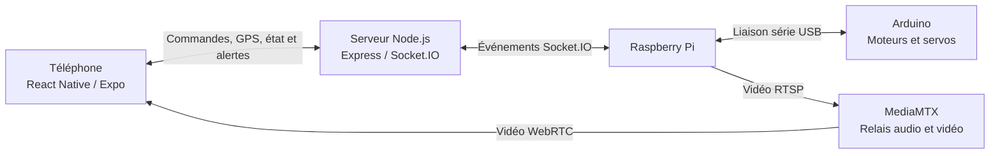

# Architecture de Hack1Robot

Hack1Robot, appelé Ping dans le code, est un robot mobile pilotable depuis un téléphone. Le Raspberry Pi embarqué coordonne les capteurs et les déplacements. L’Arduino commande les moteurs et les servos.

## Fonctionnalités

| Fonctionnalité | Utilisation |
|---|---|
| Pilotage à distance | Conduire au joystick, régler la vitesse, arrêter le robot et orienter la caméra. Un pilote commande le robot et les autres participants du salon peuvent suivre comme spectateurs. |
| Vidéo et audio | Voir la caméra en direct, écouter le micro du robot, parler dans son haut-parleur, prendre des photos et consulter les enregistrements. |
| Carte et navigation | Voir la position GPS du robot, lui indiquer une destination ou utiliser « Se rejoindre » pour partager sa position avec un contact. |
| Rondes | Faire apprendre un trajet au robot en le pilotant, puis lui demander de le rejouer. |
| Surveillance | En mode absence, le robot surveille le bruit et les mouvements dans l’image. Une détection peut produire une photo, une description de la scène et une notification, selon les réglages. |
| Assistant vocal | Le serveur traite les échanges vocaux et peut transmettre des actions au robot. Le mode conversation en temps réel utilise OpenAI lorsqu’il est configuré. Le code prévoit aussi des appels d’alerte via Twilio. |

## Composants

- **Téléphone.** L’écran principal contient le joystick, la carte, le lecteur vidéo et les historiques. Expo Router organise les écrans. Des modules React Native natifs gèrent notamment la carte et WebRTC. [Écran principal](app/%28tabs%29/index.tsx)
- **Serveur.** Le code de salon associe le téléphone et le robot. Le serveur attribue le rôle de pilote, relaie les commandes et diffuse les positions et états. Express expose les routes HTTP de consultation des alertes et enregistrements. Le serveur garde les salons, rôles et files d’attente en mémoire. Il écrit notamment les jetons de notification et l’historique des alertes sur disque. [Serveur](server/server.js)
- **Raspberry Pi.** Le programme embarqué lit le GPS, gère la caméra et le micro, calcule les corrections de cap et envoie les ordres de déplacement à l’Arduino. [Point d’entrée](robot/robot.js) · [Navigation](robot/navigation.js) · [Rondes](robot/ronde.js)
- **Arduino.** Le firmware reçoit les ordres du Pi par liaison série et pilote le matériel. Le dépôt contient plusieurs firmwares correspondant à différents montages et essais. [Firmwares](robot/arduino)

## Deux exemples de bout en bout

1. **Pousser le joystick vers l’avant.** L’application émet l’événement `robot_drive`. Le serveur vérifie le rôle de pilote et relaie l’ordre au Raspberry Pi. Le Pi envoie la commande sur le port série de l’Arduino, puis renvoie un état à l’application via le serveur. [Relais côté serveur](server/server.js#L879) · [Réception côté robot](robot/robot.js#L1462)
2. **Ouvrir la caméra.** Le Pi publie la vidéo H.264 en RTSP vers MediaMTX. L’application lit ce flux en WebRTC avec l’aide du serveur pour négocier la connexion. Si WebRTC est indisponible, un flux de secours transmet des images JPEG successives. [Capture](robot/camera.js) · [Lecture](app/%28tabs%29/index.tsx#L2481)

Le [README du robot](robot/README.md) couvre la configuration du GPS, l’appairage et la liaison Arduino. Cette description s’appuie sur le code du dépôt. Le robot physique et les services déployés n’ont pas été testés.
